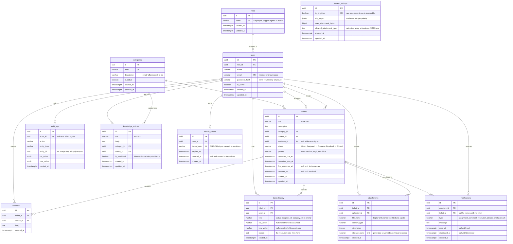

# Data model

Status: opened by F05 (database schema and migrations), 9 October 2026; D01
landed 10 October and D02-D06 landed 14 October 2026.

[REQUIREMENTS.md](REQUIREMENTS.md) says what the system must do and
[API_CONTRACT.md](API_CONTRACT.md) says what the API exchanges. Neither decides
the column-level questions those two imply: which checklist row owns which
table, what every constraint is named, and which conventions hold for every
table. This file is that third agreement.

Read it before writing a model or a migration, and change it in the same commit
as the model or migration it describes, the way the other two documents are
changed.

## What F05 decided

F05 owns the migration **mechanism**. The baseline revision
`20261008_2150_baseline` creates no tables, on purpose:

- the chain needs a root before anything can be added to it, and
  `alembic upgrade head` can be proven against the running container while the
  schema is still empty, so a later failure is unambiguously about a later
  revision;
- `app/models/__init__.py` fixes the naming convention (below) before any table
  exists. Constraint names are compared by name during autogenerate, so renaming
  them once a table exists costs a migration per rename.

The tables and their minimal ORM models arrive together with D01-D06, and
`refresh_tokens` with A02. D07 adds no table: it wires the models to each
other and adds the session factory and transaction boundary. Keeping each model
beside its migration lets `test_models_match_the_database` detect drift from D01
onward.

## Naming conventions

Every table inherits this metadata convention from `app/models/__init__.py`, so
a constraint can be named in a migration review and found in the database
without opening it:

| Kind | Pattern | Example |
| --- | --- | --- |
| Primary key | `pk_%(table_name)s` | `pk_tickets` |
| Foreign key | `fk_%(table_name)s_%(column_0_N_name)s_%(referred_table_name)s` | `fk_tickets_assignee_id_users` |
| Unique | `uq_%(table_name)s_%(column_0_N_name)s` | `uq_users_email` |
| Check | `ck_%(table_name)s_%(constraint_name)s` | `ck_tickets_status` |
| Index | `ix_%(table_name)s_%(column_0_N_name)s` | `ix_tickets_status` |

Check constraints must therefore be given an explicit `name=` in the model, or
the generated name collapses to a bare `ck_<table>_`. Table names are plural
`snake_case`; column names are singular `snake_case`.

## Conventions that apply to every table

Each of these restates a decision from the two documents above and gives it a
storage shape. Do not vary one table at a time.

- **Primary keys are UUIDs**, stored as PostgreSQL `uuid`, and are exposed in
  JSON as strings. The contract says IDs are UUID strings.
- **Timestamps are `timestamptz` in UTC**, written as `datetime.now(timezone.utc)`,
  and serialised as ISO 8601 ending in `Z`. Never a naive timestamp and never a
  server-default `now()` that the application cannot see.
- **`created_at` and `updated_at` on every table** except the append-only ones
  below, which carry `created_at` only because they are never updated.
  `refresh_tokens` also omits `updated_at`: its only state change is revocation,
  recorded specifically by `revoked_at`.
- **Nothing is hard-deleted** in v1: not tickets, comments, attachments,
  articles, or users. Users are deactivated; the rest are withheld from list
  routes by a flag or a status instead of a `DELETE`.
- **Ticket History and Audit Logs are append-only.** They are written in the same
  transaction as the change they describe, so a rolled-back change leaves no
  entry, and no route updates or deletes a row.
- **Enumerated values are stored as text with a check constraint**, not as
  PostgreSQL `enum` types, because altering a `enum` needs its own migration
  dance and the naming convention above already gives the check a stable name.
  The closed sets are: ticket status, ticket priority, and role.
- **Foreign keys that point at a record the UI must still be able to name** are
  `ON DELETE RESTRICT`, which is what "no hard delete" means in practice.
- **SLA targets are copied onto the ticket at creation**, not looked up at read
  time, so a later settings change never rewrites an existing deadline.

## Table ownership

| Row | Tables | Notes |
| --- | --- | --- |
| F05 | *(none)* | Mechanism only. `alembic_version` is Alembic's own table. |
| D01 | `users`, `roles` | Users reference one of the three fixed roles. |
| D02 | `tickets`, `categories` | Core ticket and category records. |
| D03 | `comments`, `ticket_history` | Conversation and immutable ticket changes. |
| D04 | `attachments`, `audit_logs` | File metadata and immutable activity records. |
| D05 | `notifications`, `system_settings` | Personal notices and admin settings. |
| D06 | `knowledge_articles` | Knowledge-base content. |
| A02 | `refresh_tokens` | Hashed refresh tokens for session management. |

This assignment now matches the local project checklist. The prior F05 draft
mapped D02-D06 differently; D01 corrected the bookkeeping before later tables
were added.

## ER diagram

F05's second acceptance item is an ER diagram covering "every database entity in
the architecture". The picture in the mentor workbook names ten tables in its
database layer; D06 added `knowledge_articles` as the eleventh, because the
knowledge base appears in the workbook's React layer and needed somewhere to
live. A02 adds refresh-token sessions as the twelfth table. All twelve are
drawn below.

`|o` and `o{` on a left/right pair read as "zero or one" and "zero or more", and
`||` as "exactly one". Three lines are drawn `|o` on the user or ticket side
because the foreign key is nullable: a ticket is unassigned until an agent takes
it, a failed sign-in has no actor, and a notification need not point at a
ticket. Everything else is a required pointer. All sixteen foreign keys are
restrictive, which is how "nothing is hard-deleted" is enforced.

`alembic_version` is deliberately absent: it is Alembic's own table, not part of
the model. A02 adds `refresh_tokens`, whose raw value exists only in the client
and is rotated on refresh or revoked on logout.

`backend/tests/test_er_diagram.py` guards this section. It parses the block
above and fails if a table, a column, a unique constraint, or a foreign key in
the ORM metadata is missing from the diagram, or if the diagram invents
something the metadata does not have. The check needs no database, so it runs
even when nothing is listening on 5432.

## Columns the contract already fixes

These follow from the response fields and rules in `API_CONTRACT.md` and are
listed so a D-row does not have to rediscover them:

- `users`: name, email (unique), password hash, role, active flag. The password
  hash is never returned by any route.
- `categories`: name (unique), description, and an active flag. Deactivating a
  category leaves existing tickets valid; the API lists active categories only.
- `roles`: one of the three fixed names Employee, Support agent, or Admin. D01
  stores names only; A03 will enforce their permission sets from
  `REQUIREMENTS.md` in backend code. There are no editable permission columns
  or rows in v1 because the contract has no role-permission editing API.
- `tickets`: title, description, `category_id`, `creator_id`, `assignee_id`
  (nullable while unassigned), status, priority, `response_due_at`,
  `resolution_due_at`, `first_response_at`, `resolved_at`, `created_at`,
  `updated_at`. `response_overdue` and `resolution_overdue` appear in the
  ticket response but are **derived** from the due and actual timestamps against
  the current clock, so they are not stored columns.
- `comments`: ticket, author, non-blank body, and UTC time. No `updated_at`:
  there is no comment update route in the contract, so a comment is never
  edited.
- `ticket_history`: actor, the changed field, old value, new value, reason where
  the change needed one, and UTC time. `reason` is also where the resolution
  note lives, because the contract's Ticket shape has no such field.
- `audit_logs`: `actor_id` (null on a failed sign-in, where only the attempted
  email is stored), action, `entity_type`, `entity_id`, `old_value`,
  `new_value`, `created_at`. The two value columns are `JSONB`.
- `notifications`: owner, and **two independent** timestamps, read and
  dismissed, because a notification may be read and still listed, or dismissed
  without being read. `type` is one of the five values the contract lists.
- `attachments`: metadata only. File bytes live under `uploads/` at the
  repository root, outside anything the app serves; the stored name is generated
  server-side and a client-supplied file name is never used to build a path.
- `knowledge_articles`: title, body, category, author, and a published flag.
  Drafts are visible to their author agent and to admins; employees see
  published only. Articles reuse the `categories` table used by tickets.
- `system_settings`: SLA targets per priority, attachment size limit, and
  allowed file types. One row only, seeded by D05 with the defaults in
  `REQUIREMENTS.md`.
- `refresh_tokens`: the hash of the token, never the token itself, plus its
  owning user and expiry, so logout can revoke exactly one.

## Not yet decided here

D01-D06 have all landed, and D06 settles the article-category shape below. D07
settles shared relationships and session handling, also below. A02 adds
`refresh_tokens`.

## D01 decisions

- `users.role_id` is a required foreign key to `roles.id`; the database blocks
  deleting a role while any user references it. Users themselves are deactivated,
  not deleted.
- `roles.name` is unique and limited to the three agreed names. The permission
  matrix remains in `REQUIREMENTS.md` until A03 implements it.
- `users.email` is unique and stored trimmed and lowercase. The database rejects
  non-normalized values, so a later API must normalize before insertion and
  login lookup. User name and password hash cannot be blank. The hash is never
  exposed in an API response.
- Both tables use UUID primary keys and application-written UTC timestamps.

## D02 decisions

- `tickets` carries the contract's Ticket columns. `response_overdue` and
  `resolution_overdue` stay out of the table: they are derived from
  `response_due_at`, `resolution_due_at`, and the clock, so a stored copy could
  only go stale.
- The closed sets are text plus a `CHECK`, and they match `REQUIREMENTS.md`
  exactly: status `Open, Assigned, In Progress, Resolved, Closed`, priority
  `Low, Medium, High, Critical`. Both are case-sensitive, so `open` or `medium`
  is rejected rather than silently accepted.
- Which status may follow which is deliberately **not** a database constraint.
  The legal transitions, and who may make them, are T02 business rules; encoding
  them here would fight T02 and make a legitimate intermediate state
  unrepresentable.
- `tickets.category_id` is required and restrictive, so a category tickets still
  use cannot be deleted. `creator_id` and `assignee_id` are restrictive the same
  way, and `assignee_id` is nullable because a ticket starts unassigned.
- `response_due_at` and `resolution_due_at` are required and are copied from the
  SLA targets in force when the ticket is created; nothing recomputes them on
  read, so a later settings change cannot rewrite an existing deadline.
- Indexes cover `category_id`, `creator_id`, and `assignee_id` only. `status`
  and `priority` are not indexed because 5 and 4 distinct values make a
  sequential scan the cheaper plan at demo size. Revisit with real volume.
- The model and the migration must declare the same indexes; `alembic check`
  runs inside `tests/test_migrations.py` and fails on drift. It caught exactly
  that during D02, which is why the status and priority indexes were dropped.
- A revision id must fit `alembic_version.version_num`, which is `varchar(32)`.
  D01's `<date>_<counter>_<row>_<slug>` pattern does not scale:
  `20261014_0001_d02_tickets_categories` is 36 characters and PostgreSQL
  rejects it. D02 uses `20261014_d02_tickets_categories` (31 characters). Later
  rows must stay at 32 or fewer, so a long slug means dropping the counter
  rather than truncating the date.
- The resolution note lives in `ticket_history.reason` (D03), not on `tickets`.
  The contract's Ticket shape has no resolution-note field, while
  `POST /tickets/{id}/status` requires one when moving to Resolved.
- `categories.description` is `NOT NULL`: the contract's Category shape always
  carries it and never marks it nullable. Empty is allowed, null is not.

## D03 decisions

- `comments` and `ticket_history` carry `created_at` only, with no `updated_at`.
  Neither has an update route in the contract: a comment is never edited, and a
  history row is written once, in the same transaction as the change it
  describes.
- `ticket_history.field` is a closed set enforced by a check constraint:
  `status`, `assignee_id`, `category_id`, `priority`. That is exactly the list of
  changes `REQUIREMENTS.md` says must be recorded. The closed set is schema; the
  meaning of a change is not.
- "One row per changed field" is enforced by the API that writes the rows
  (T02/T03), not by a constraint, for the same reason transitions are not
  constraints: an `old_value IS DISTINCT FROM new_value` check would have to be
  revisited by T02 and could reject a legitimate record. This is deliberate.
- `old_value` and `new_value` are `varchar(64)`: a status or priority label, or
  the string form of a UUID. `reason` is `text`, because the resolution note
  lands there.
- **Index strategy**, which the F05 draft left to this row: each table gets one
  composite index on `(ticket_id, created_at)`. The contract's only read routes
  for these tables filter by ticket and order oldest first, so one index serves
  both the filter and the ordering. There is deliberately no index on `author_id`
  or `actor_id`: no route looks a comment or a history row up by author, and at
  demo size the restrictive delete check does not need one. Revisit if a report
  ever filters by actor.
- Neither table is reachable by a write route. `GET /tickets/{id}/history` and
  `GET /tickets/{id}/comments` are readers; the rows are written by the ticket
  routes in the same transaction as the change.

## D04 decisions

- **Attachment storage layout**, the other question the F05 draft left open.
  Bytes live under `uploads/` at the repository root: `.gitignore` already
  excludes it, and nothing the FastAPI app or the Vite dev server serves comes
  from there. A file sits at
  `uploads/<first two characters of storage_name>/<storage_name>`, so a demo with
  thousands of files does not put them all in one directory.
- `storage_name` is generated server-side: a UUID4 in hex plus an extension
  chosen from the allowed types by MIME type. The client's `file_name` is kept
  for display only. `storage_name` is the one column the contract hides from
  responses, and it is unique and non-blank.
- The table stores `storage_name` with no directory part, and the root is
  composed when a file is read. Moving `uploads/` therefore invalidates nothing
  and needs no migration.
- Attachment rows are write-once: no `updated_at`, and no update or delete route
  in v1. `size_bytes` must not be negative; the upper limit and the allowed types
  come from settings and are enforced by the API, because the limit is
  configurable and a check constraint cannot track it.
- **Audit-log index strategy**, the other F05 open question. One index on
  `created_at` serves the newest-first listing route, and one on
  `(entity_type, entity_id)` serves a single record's own history. `actor_id` and
  `action` are deliberately unindexed: each narrows the listing rather than
  being a lookup of its own, and at demo size the `created_at` index already
  bounds the scan.
- `old_value` and `new_value` are `JSONB` rather than `JSON`: the contract says
  "nullable JSON", and only JSONB can be indexed if a later report needs to
  query inside a value.
- `action` and `entity_type` carry no closed set. The contract names filter
  values but never fixes the vocabulary, and G01 owns the exact strings; a
  non-blank check only stops an empty string.
- `entity_id` has no foreign key because it identifies whatever `entity_type`
  names, so it cannot point at one table. `actor_id` does, and is nullable for
  the failed sign-in that has no actor.

## D05 decisions

- **Settings is one row read as a singleton**, not a key/value table. The
  contract's Settings shape is a single object, so a single row is the honest
  storage. `is_singleton` plus a unique constraint is what makes a second row
  impossible, and it keeps the UUID primary key convention the other tables
  follow. A key/value table would have needed a different shape for the same
  contract.
- **D05 seeds that row in the migration**, with the SLA targets, size limit, and
  allowed types from `REQUIREMENTS.md`. This is the first migration that writes
  data. Two reasons: the contract calls them "seeded defaults editable by an
  admin", and T01 cannot compute a ticket's deadlines without the row existing.
  Demo users and tickets stay in D08; this is reference data the system cannot
  run without. The row's id is a fixed UUID, so the API can address it without a
  lookup by "the only row".
- `sla_targets` is `JSONB` with a check constraint that all four priorities are
  present as keys. The inner pair of hours is the API's to validate, because the
  check cannot see inside the objects without freezing their exact shape.
- `allowed_attachment_types` is a native `text[]`, not JSONB: the contract says
  "array of MIME type strings", and a native array is what that is. A check
  constraint requires at least one entry.
- `max_attachment_bytes` must be positive. It is the limit D04's attachments are
  measured against, and the seeded value is 10 MiB.
- `notifications.type` is a closed set as a check constraint, matching the five
  values in the contract: `assignment`, `comment`, `resolution`, `closure`,
  `sla_breach`. A reassignment uses `assignment`.
- `notifications` carries one composite index on `(recipient_id, created_at)`,
  which serves the default list (current user, newest first) for both the
  dismissed-excluded and dismissed-included variants. `ticket_id` is unindexed:
  no route lists notifications by ticket.
- `system_settings` is the only table besides `roles`/`users`/`categories`/
  `tickets` that carries `updated_at`, because `PATCH /settings` exists and
  edits it in place. A notification is edited only through its read and dismiss
  routes, which have their own timestamps, so it has no `updated_at`.
- Settings changes are audited by G01, in the same transaction as the change, so
  no separate history table is needed here.

## D06 decisions

- `knowledge_articles.category_id` is a required foreign key to the existing
  `categories` table, not a new article-only category table. The checklist
  requires a category, and the contract has no route for managing another kind.
  The foreign key restricts deletion; a deactivated category may remain on an
  existing article. The article API accepts only active categories on creation
  or recategorization. This is an API rule because active state can change.
- `author_id` is a required, restrictive foreign key to `users.id`; inactive
  authors still retain attribution. The API enforces which roles may author or
  edit; a foreign key cannot encode role permissions.
- `title` is `varchar(200)` and `body` is `text`, both required and nonblank.
  `is_published` defaults to false in the model. Only an admin may change it
  through the publish route. `created_at` and `updated_at` are UTC timestamps.
- Indexes on `category_id` and `author_id` support category filtering and own
  draft lookup. The published flag is deliberately not indexed by itself: it
  has only two values and the initial database is small.

## D07 decisions

D07 adds no table and no column: it is the Python side of the data access layer
the architecture picture names, and `alembic check` still reports no drift after
it. Nothing here changes the schema, so nothing here needs a migration.

- **Every foreign key has a relationship, and both directions are navigable.**
  Each of the fifteen keys gets a `relationship()` on the child and a
  `back_populates` collection on the parent, so a route reads
  `ticket.category.name` instead of hand-writing a join. The two ambiguous links
  are `tickets.creator_id` and `tickets.assignee_id`, which both point at
  `users`; each side names its foreign key explicitly rather than leaving
  SQLAlchemy to guess. The reverse collections are named for the role they play
  — `tickets_created` and `tickets_assigned`, `ticket_history_entries` — because
  `User.tickets` twice over would say nothing about which link it was.
- **Deleting a related row is a database question, not an ORM one.** No
  relationship sets `cascade="all, delete"`, so a `session.delete(user)` cannot
  quietly take tickets, history, or audit rows with it; the restrictive foreign
  keys raise instead. This is what "nothing is hard-deleted" means once an ORM is
  in front of the tables.
- **`autoflush=False`.** A query never writes a half-built object as a side
  effect, so a request that fails before committing cannot leave a row that
  another query flushed into existence.
- **`expire_on_commit=False`.** After a commit the object keeps its values, so a
  route can commit and serialise what it just wrote without a refresh round trip.
- **The request is one unit of work, and the caller commits it.**
  `API_CONTRACT.md` requires a ticket change to update the ticket and append its
  history, audit, and notification rows "together or roll back together", which
  is one transaction per request. `app.core.db` therefore owns the failure path,
  not the commit: `get_db` rolls back if the route raises and always closes, and
  `session_scope` is the same contract for scripts and tests, committing on
  success and rolling back on error.
- **Lazy loading is the default.** No relationship sets `lazy="joined"` or
  `selectin`. List routes are T01's and later, and eager-loading fifteen
  collections before those routes exist would guess at their query shapes; a
  route that needs to avoid N+1 can say so where it is written.
- `backend/tests/test_relationships_and_sessions.py` holds the line. One test
  needs no database and fails if a foreign key has no relationship, if a
  `back_populates` names something that does not exist, or if a relationship
  appears that no foreign key justifies. The rest run real PostgreSQL and prove a
  relationship loads from the database, that a commit is visible to a later
  session, and that a rollback leaves nothing behind.

## D08 demo seed

D08 adds no schema or migration. `python -m app.seed_demo` is an opt-in local
setup step after `alembic upgrade head`. It inserts three roles if absent, one
synthetic user per role, three clearly labeled demo categories, and five
sample tickets spanning the lifecycle states. Stable UUIDs and `example.test`
emails identify demo-owned rows; reruns only add missing rows and never update
an existing password or ticket. A name/email collision with another row fails
instead of claiming that row as demo data. The script commits as one unit of
work, so an error leaves no partial seed.

The password is prompted locally and stored only as a salted PBKDF2-SHA256
hash. A01 uses `app.core.passwords.verify_password` for these seeded
accounts or deliberately migrate the hash format. Ticket deadlines are copied
from the current `system_settings.sla_targets` on the initial seed run.
Seeded tickets are synthetic state snapshots, not simulated user requests;
they do not create ticket history or audit events. Later API changes do.
